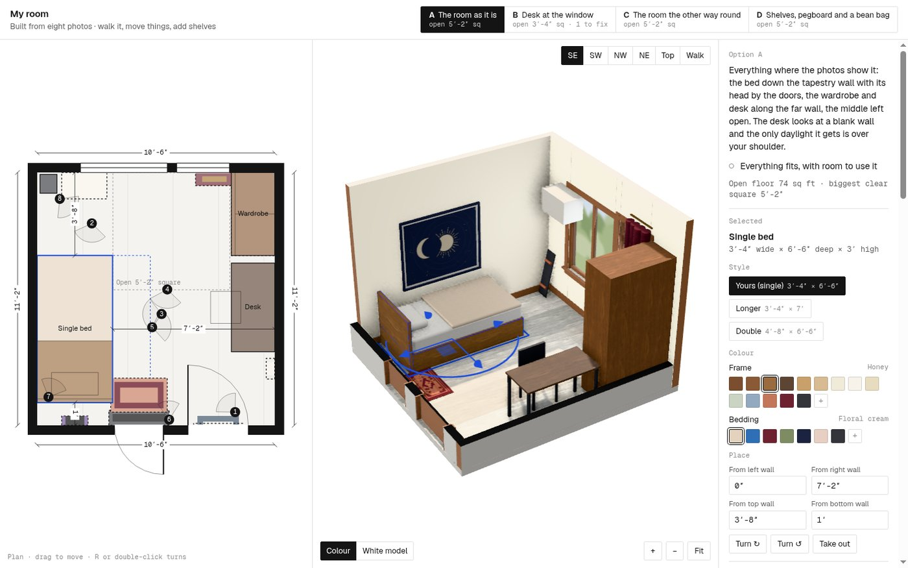
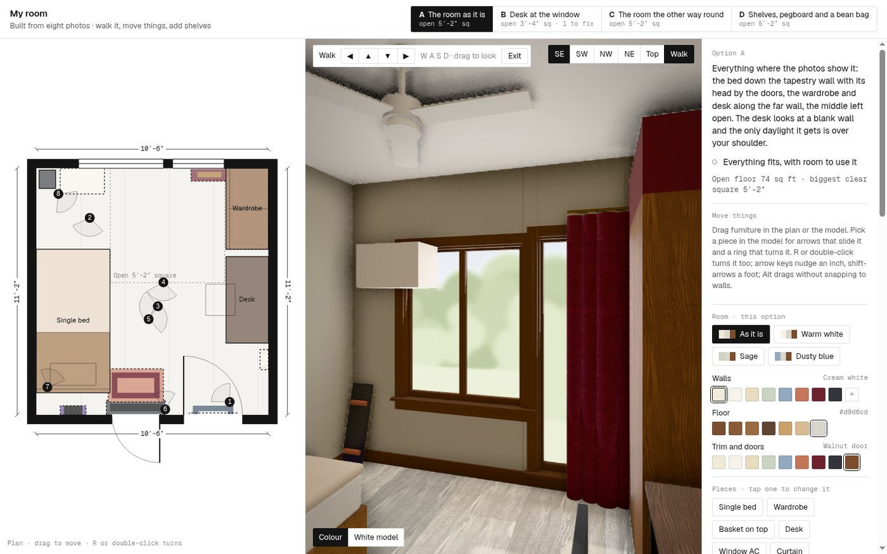
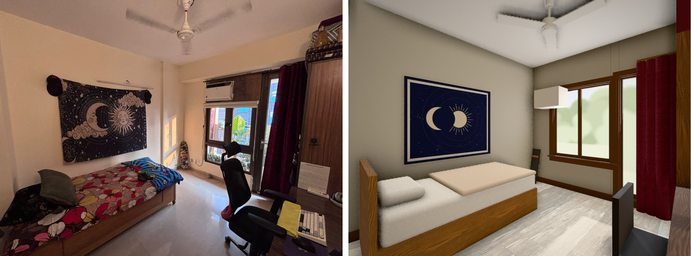

# My Room

My bedroom as a 3D model, built from eight phone photos — no floor plan, no tape measure. It opens
in a browser: walk it in first person, drag the furniture around, compare four layouts, and add or
take out shelves, a pegboard and a bean bag.



Everything is one HTML file. Three.js comes from a CDN; the rest — geometry, finishes, the UI — is
inline, so the whole thing is a folder you can copy anywhere.

## Run it

```sh
sh room.sh            # serves this folder on 127.0.0.1:8080 and opens it
sh room.sh 8090       # …on another port
```

It has to be **served**, not double-clicked: opened as `file://` the browser refuses to read
`textures/` and `photos/`, so the finishes fall back to drawn ones and the photo overlays go blank.
Any static server works — `python3 -m http.server` is all `room.sh` does.

Layout changes are saved in the browser, per port. Stick to 8080 and the room comes back as you
left it.

## What it does

**Walk it.** The `Walk` button in the view bar drops you inside the room at eye height.
`W A S D` or the arrow keys to move, `Shift` to go faster, drag — or click once to lock the
pointer — to look around, `Esc` to come back out. Walls and furniture stop you. On a phone there's
a d-pad.



**Orbit it.** `SE · SW · NW · NE · Top` are fixed camera positions; drag to orbit, wheel to zoom,
`+ − Fit` if you lose the room. The dollhouse view cuts away the near walls so you can see in.

**Move things.** Drag any piece in the plan or in the model. Select one and arrows slide it, a ring
turns it in 15° steps, `R` or a double-click turns it 90°, arrow keys nudge an inch and
`Shift`+arrows a foot. Hold `Alt` to drag without snapping to walls, or type exact distances into
the four "From … wall" boxes.

**Add and remove.** *Add a piece* opens a catalogue — sofas, tables, storage, beds, lamps, plants,
rugs, art — with my own four at the top: pegboard, floating shelf, shelf unit, bean bag. A new piece
lands in the clearest spot, then drags, turns, recolours and takes size variants like everything
else. `Delete` removes one; it waits in the library under "In this room" in case I want it back.

**Check it.** Every change is re-checked live: pieces running into walls, overlaps, anything sitting
in a door's swing, blocked fronts (a desk needs 30″, a wardrobe 36″), a bed with no side to get out
of, tall things in front of the window, and how much open floor is left.

**Repaint it.** Four one-click looks, and swatches for the walls, floor, trim and every piece.

**Four layouts.** *The room as it is* · *Desk at the window* · *The room the other way round* ·
*Shelves, pegboard and a bean bag*. Each one carries its own trade-off note, and its own furniture
positions, colours and added pieces.

## The room

Nothing here was measured. The sizes were solved: I picked door jambs, window reveals, tapestry
edges, wardrobe corners and room corners out of the photos and least-squares fitted the room and all
eight camera positions together. Heights come from each photo's own ceiling and floor lines, and the
absolute scale rests on the 80″ door openings.

| | |
|---|---|
| Room | 126 × 134 inside (10′-6″ × 11′-2″), ceiling 108″ |
| Window | 46 wide, sill 26, head 82, 23″ from the west corner |
| Window AC | 24 × 15 × 14, inside the window head, underside 67 |
| Balcony door | 28 wide, glazed 5 → 84, 5″ east of the window |
| Hall door | 32 × 80, hinged on its west jamb, swinging in |
| Bath door | 26 × 80, swinging out, 13″ of wall between the two jambs |
| Bed | 40 × 78, mattress 22 up, headboard 36, 10″ off the door wall |
| Wardrobe | 44 × 23 × 84, with a 15″ basket on top |
| Desk | 47 × 23 × 30, standing 4″ clear of the wardrobe |
| Tapestry | 54 × 46, bottom edge 31 up |
| Guitar | 14 across, hanging 40 → 81 |
| Deck shelf | 32 wide at 80, over the bath door |
| Leaning skateboard | 31 tall, 10″ west of the window |
| Curtain | 20″ of bunched panel, 92 long |
| Wall sconce | 11 × 5½, 85 up |
| Door rug | 30 × 18 · ceiling fan 48″ sweep on a 13″ drop · floor as 24″ tile courses |

The same list is on the page, under the plan. Colours were sampled from lit patches of the photos.

### How close it is

The *Photos* tab draws the model over each original shot — that is the test, not my opinion of it.



Photos 1, 3, 4, 5 and 6 land within a few percent of the frame. The overlays drift most at the frame
edges, where the wide phone lens bends straight lines in a way a pinhole 3D camera cannot follow. Two
things the photos genuinely do not settle: which jamb the hall door hangs on, and the length of the
room — no single photo shows both end walls — so 11′-2″ carries the most uncertainty of any number
above.

To correct something: edit the size in `config.js`, or tune a camera live in the *Photos* panel and
press *Copy camera* to get the numbers back.

## Editing

`config.js` is the whole room — outline, openings, every piece, the four layouts, the palette, the
photo cameras. After changing it:

```sh
sh build/make.sh        # rebuild index.html from config.js
python3 build/check.py  # re-run the geometry audit and the fit checks
```

`build/make.sh` needs the `room-from-photos` skill on disk, because the 3D engine lives there and
gets spliced together with this room's config:

```sh
claude plugin marketplace add SkylarKitchen/skills --scope local
claude plugin install skylarkitchen-skills@skylarkitchen -s local
```

Set `SKILL=/path/to/room-from-photos` if it sits somewhere else. `index.html` is committed, so none
of this is needed just to open the room.

## Files

```
index.html        the room — open this (built; do not edit by hand)
config.js         the room described: sizes, openings, pieces, layouts, cameras
room.sh           serve the folder on localhost and open a browser
photos/           the eight photos the model was built from
textures/         CC0 material scans the finishes are tiled from
docs/             screenshots for this README
build/
  make.sh         config.js + the engine -> index.html
  patch.py        this room's engine extensions (see below)
  check.py        geometry audit and fit checks, headless
  shot.sh         one headless screenshot, retried until it is not a blank frame
  phone.html      390x844 iframe harness, for checking the phone layout
```

### build/patch.py

The stock engine did not cover everything in this room, so `patch.py` adds, as anchored edits
applied after each build:

- **walk mode** — first-person movement with collision, pointer-lock look, WASD and a touch d-pad
- **new pieces** — wall shelf, pegboard, bean bag, curtain, sconce, guitar, skateboard, wall-mounted boxes
- **the tapestry print** — the sun-and-moon cloth, drawn to canvas
- **the ceiling fan**, and **closed doors**, since the engine draws doors standing open

## Credits

- 3D engine from the [`room-from-photos`](https://github.com/SkylarKitchen/skills) skill
- [three.js](https://threejs.org) r162, loaded from jsDelivr
- Material scans from [ambientCG](https://ambientcg.com), CC0 — see `textures/SOURCES.md`

Private repo: the photos are of my own room.
